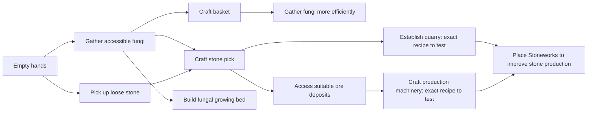

# MORE THAN ENOUGH — Game Design Document

Updated 2026-10-23 (Europe/Vilnius). The confirmed redesign below is the current design direction, not a description of shipped mechanics. The earlier physical-progression design is retained below as historical context. Decisions in the current section take precedence over earlier proposals.

## Evolve the existing game — confirmed implementation constraint

Keep the existing universe, artwork, character, terrain presentation, movement,
exploration, controls and recognizable game client. The resource, cultivation,
logistics and restoration redesign must evolve those systems. Do not replace
them with a newly built map, character, interface or separate playable prototype.
Use one main game and ship accepted changes to main. Earlier worlds remain
preserved. A replacement client/world attempted during development was rejected
before commit or deployment; it is not the implementation direction.

## Current redesign — confirmed decisions, 2026-10-23

### Player promise and core activity
Start empty-handed on the surface and build a settlement capable of restoring a dormant machine deep underground. Most player time should go into exploration, designing production sites, and building transport and support infrastructure. Manual gathering bootstraps development and remains a fallback; it is not the primary late-game activity.

### Exactly four economic resources

| Resource | Main location | Intended role | Visual direction |
|---|---|---|---|
| Mycelium | Surface | Baskets, bindings, cultivation beds and flexible components | Pale woven fibres and branching growth |
| Stone | Mainly surface; also present underground | Foundations, workshops, chamber walls and shutters | Heavy blocks and slabs |
| Metal | Underground, accessible before deep crystal | Picks, lifts, collection machinery and structural equipment | Frames, gears, rails and cables |
| Living crystal | Deep underground | Advanced devices and restoration of the machine | Distinct branching crystalline forms |

The player accepted this four-resource direction. Metal is the economic resource; ore deposits can be its natural source without introducing a fifth refined-metal currency. Starter colony/specimen mechanics remain unresolved: do not silently add a fifth economic resource or an inventory micromanagement system.

Surface mycelium/stone bootstrap the settlement. Descending for metal enables underground infrastructure, followed by deep crystal cultivation. Surface ore/crystal deposits and surface buildings that generate these materials without underground dependencies conflict with this direction and need redesign in the new model. Exact depth thresholds, scarcity, recipes and geological distribution remain unbalanced. This does not authorize rewriting previously explored legacy terrain or stripping earned stockpiles.

### Living-crystal cultivation
- Darkness is required for production.
- Cultivation requires deep underground chambers, not just an opaque box on the surface.
- Players also manage temperature: separate growing spaces from hot machinery and build cooling infrastructure.
- Environmental management remains relevant during operation; the exact degree of automation and intervention is undecided.
- Colonies can die when conditions are unsuitable. Backup chambers and recovery matter.
- Any light exposure causes colony damage, making sealed handling essential. Damage rates and lethal exposure duration remain to be designed; this decision does not imply instant death.
- Renewable wild colonies underground supply starter specimens, allowing recovery even after all cultivated colonies are lost. Regeneration timing and specimen collection/transport rules remain open.
- Dangerous heat is communicated primarily through visible changes and sound cues. Inspecting a chamber reveals its exact temperature. Specific cues and accessible alternatives remain to be designed.
- Thermal thresholds, heating/cooling behavior, damage accumulation and recovery rates are not specified yet.

### Machine restoration and completion
Restoring the dormant underground machine is the world-completion objective. The settlement supplies its restoration. Discoveries progressively reveal the machine's purpose, with its main effect reserved for the ending.

The earlier alternative of intermediate repairs primarily activating useful lifts, pumps and passages was not selected; nor was landscape restoration selected as the main repair payoff. Exact machine purpose, repair stages, discovery delivery and final activation are still open. Completing all legacy upgrade tracks is not the intended new-model victory condition.

### Retained requirements
Every new world starts empty-handed; only knowledge and records carry over. Every purchase and upgrade needs a physical identity. Building functions and outputs must be visually understandable. White chalk accents suit planning and construction where readable. Avoid filler, forced waiting and maintenance click taxes; forty meaningful hours is a future content goal, not a reason to stretch prices or timers. AUTO remains a fair development tool subject to human rules and information. Preserve all existing worlds and earned progress; multiplayer hardening remains deferred.

### Recommendations awaiting confirmation
These are design recommendations, not approved rules:
- Clear warning signs and enough time to respond before a colony dies.
- A recoverable path after losing all cultivated colonies, so the world cannot become unwinnable.
- Simulated darkness that does not require an unreadably dark screen.
- Infrastructure that solves recurring problems without constant switch toggling.

### Latest confirmed choices, 2026-10-23
1. Light: any exposure damages colonies; sealed handling is essential.
2. Total-colony-loss recovery: find renewable wild colonies underground and collect starter specimens.
3. Heat warnings: visual and sound cues first; inspect a chamber for exact temperature.

### Crystal handling and repair — confirmed decisions, 2026-10-23
- First starter: players carefully carry a specimen with a short exposure budget before sealed transport is built. A protective carrier is not a prerequisite for the first specimen. Exact exposure limits, light sources, temperature effects and handling controls remain unspecified.
- All crystal stays sensitive, including harvested construction material. Protected storage and transport are required; harvested crystal must not be treated as a stable, globally available inventory balance that bypasses exposure.
- A surviving damaged colony needs a physical repair/tending action before it can heal. Safe conditions alone do not automatically initiate recovery. Repair equipment/materials, healing duration and possible automation remain open.
- Dead colonies still require replacement starters from renewable wild colonies. Tending a surviving colony is distinct from reviving a dead one.

### Implications to resolve — not additional approved mechanics
- Plan a feasible early collection route within the specimen's exposure budget; later sealed infrastructure should remove repeated hazardous hand-carrying. Exact route guarantees and infrastructure behavior need design.
- Define protection at every material handoff: harvesting, storage, transport, delivery and installation in the final machine. Installed crystal has a confirmed continuing cooling/darkness requirement; its delivery and installation procedures remain open.
- Decide how carried light, inspection and the player's view interact with actual light exposure. Seeing the game should not implicitly be assigned an exposure rule.
- Damaged harvested crystal has a confirmed lower-effectiveness construction use. Exact quality handling, possible repair/reseeding and eligible uses remain open. Colony healing rules do not automatically apply to harvested material.
- Define physical tending as a meaningful action with observable results; avoid assuming a recurring click quota or abstract repair payment.

### Crystal condition and installed operation — confirmed decisions, 2026-10-23
- Exposed carried crystal communicates damage through visible cracks and sound cues, plus a clear remaining-tolerance meter. This is a tolerance/condition indicator, not a promised fixed countdown. Its response to changing light and temperature remains to be specified.
- Harvested crystal damaged by light or heat loses effectiveness but remains usable for less demanding construction. It is not automatically destroyed or assigned a restoration-facility loop. Exact quality requirements, degradation limits and eligible construction uses remain open.
- Installed crystal in equipment and the underground machine still needs ongoing cooling and darkness supplied by settlement infrastructure. Installation does not permanently stabilize crystal or end the protection requirement.

### Consequences requiring further design
- Represent crystal condition within the existing four-resource economy; quality is not permission to add a fifth resource. Storage, selection and delivery rules must preserve condition without burdensome per-piece micromanagement.
- Specify how construction selects suitable crystal, how degraded material is used, and whether installed quality affects capability or efficiency. No recipe thresholds or numerical penalties are agreed yet.
- Explain environmental dependency visibly at the consuming structure. Design infrastructure that can support reliable operation; ongoing requirements do not themselves imply manual maintenance clicks or unavoidable periodic failures.
- Define failure and recovery of installed crystal, particularly in the final machine, without conflating material degradation with death of a cultivated colony. Activation/completion behavior after environmental failure remains undecided.

### Other design questions still open
- What is the machine, why did it stop, and what does activating it do?
- How do players discover its parts and reveal its purpose while retaining agency?
- Which temperature conditions and machinery interactions create interesting layouts?
- How are chambers enclosed, cooled and serviced without exposing colonies to damaging light?
- How long can the first carried specimen tolerate exposure, and how does the player judge and plan a safe route?
- What light sources cause damage, how quickly does it accumulate, and what physical tending enables surviving-colony healing?
- How do wild colonies regenerate, and how do players locate a recovery source without hidden-information shortcuts?
- Which visual and sound cues distinguish safe, stressed and critically endangered colonies, including for players who cannot hear the cues?
- How do material transport and collection work between layers?
- What does each physical equipment/support upgrade let players do?
- What happens in a completed world and what knowledge/records motivate the next?

### Implementation boundary — 0.134.0
The first cultivation chapter is integrated into the existing client, artwork,
character, endless terrain, movement, generated cave connections, music and sheets.
New solo worlds use the four-resource geography and physical progression. Earlier
worlds preserve their terrain, possessions and completion path; they are archived
rather than converted or erased. The normal game has no separate prototype entry.

Implemented: cooling/dark growing chambers, renewable observed wild colonies,
short-lived exposed starters, lightproof carriers, condition-sensitive crystal,
protected storage and sealed chamber-to-vault transfer, physical tending,
degraded-crystal storage reinforcement, and the first machine-section repair.
Installed crystal still needs cooling/darkness. Recipes, 22°C growth limit,
12°C local cooling, rates and tolerance thresholds are provisional playtest values.
One repair reveals a clue; it is not the full ending or a final machine-purpose decision.

Existing global refinery/Overclock/Abundance purchases are absent from new-world
progression but remain preserved in old worlds. The existing basket/pick/footwear
chains and their art still need the broader physical-tier identity pass. AUTO
and multiplayer are not yet adapted to cultivation; no fair new-model AUTO win
or final-game duration is claimed. Transfers are currently direct sealed links
of bounded reach/throughput, not a finished multi-layer transport network.

Environment work runs at 250ms deadlines using derived local spatial indexes;
rendering is independent. The full simulation still has tick-based scheduling,
so seconds-per-full-world performance is unproven and remains an explicit goal.

## Earlier physical-progression design — historical context

The sections below capture the 2026-10-22 design and prototype work. Where they leave resource geography, crystal production or the completion project open, the confirmed redesign above now supersedes them. Remaining implementation details are not automatically accepted by retaining this history.

## Requirements established by the player
- Every new world begins with no tools, equipment or buildings; useful objects must be made from scratch. Only knowledge and records carry over.
- Every purchase produces an actual item the character uses or a real structure in the world. Purchased global multipliers, menu unlocks and stat perks do not meet this rule.
- Each production building's resource must be visually recognizable. Support structures must communicate their service equally clearly.
- Building, exploration and gathering all matter. Thoughtful decisions should be substantially stronger than repetitive gathering, which remains a useful fallback.
- Passive production can support brief pauses. Long inactivity should not dominate progression.
- Balance the meaningful gameplay we have. Forty hours is a future content goal, not a duration to create by raising prices or adding waiting.
- AUTO is primarily a fair development/test tool; final player availability is undecided. Human enjoyment is the design target.
- Existing worlds and earned progress must remain intact. Save formats stay frozen. Multiplayer hardening is deferred.
- No wood or tree cutting. Mycelium supplies binding, fiber and other organic construction roles.

Carry-over is knowledge and records only: known recipes, discovered collections and the history of preserved worlds can remain. No free equipment, construction, automatic collection or production/stat bonuses enter a new world. Knowing a recipe does not supply its materials or workshop. Existing archived worlds and earned possessions within those worlds remain intact.

## Proposed player promise
Start with your hands and learn to turn a wilderness into a useful, understandable production system. Each new object gives you a capability you can see and use. Automation frees attention for better building and exploration decisions.

## Consistent physical vocabulary

| Kind | What the player gets | What distinguishes it |
|---|---|---|
| Equipment | Basket, pick, footwear, lamp or transport item | The character equips/uses it; its capability has a visible action or effect. |
| Producer | Fungal bed, quarry, ore mine, crystal producer | A recognizable resource output, often attached to a suitable natural site. |
| Workshop / processor | A physical crafting place, or a machine with a real recipe | It makes usable objects or consumes explicit inputs for explicit outputs. A structure with no input must not be called a converter. |
| Support / infrastructure | Production support, lighting, charging, navigation or logistics structure | Its service and the things it affects are visible. |
| World project | A substantial placed construction | Gives later production a concrete purpose; candidate form for the eventual Abundance Engine. |

These describe function. Material output, site restrictions and progression stage are separate dimensions. A category does not require four symmetric copies or extra currencies. Not every category needs to exist in the first prototype.

## A first-play sequence to prototype

### 1. Empty hands, visible opportunities
The character has no manufactured tools. They can walk, inspect visible objects, gather accessible fungi, and pick up loose surface stone. No bare-handed ore/crystal mining, quarrying solid rock, excavation or swimming with an automatically supplied boat.

The world must visually distinguish loose gatherable material from a deposit that requires a tool. Existing surface stone can supply the first recipe only if its art/action makes picking up loose stone credible. Otherwise add a compatible explicit loose-stone representation; do not imply the player punches bedrock into a tool.

Hands carry the small quantities needed to bootstrap crafting. A basket must not be a requirement to collect the materials for a basket. Avoid introducing inventory-capacity micromanagement just to justify the item.

### 2. A first useful choice
Two proposed hand-crafted objects:
- Fungal-fiber basket: organic material only. Makes fungal gathering more effective; visibly carried and used.
- Stone pick: loose stone and fungal binding. Opens work on tougher deposits such as accessible ore; visibly equipped and used.

Exact prices and yields are untested. Neither first recipe requires ore, a refinery, a purchased blueprint or a pre-existing workbench. Both objects are attainable from the initial bare-handed gathering set. The basket route emphasizes quicker gathering; the pick route emphasizes access and exploration. Neither should be a trap or long mandatory detour.

Crafting by hand is an explicit player action producing an owned item, not an abstract capability purchase. A later workshop can make more complex objects.

### 3. A first physical producer
A fungal growing bed is a candidate first producer using early material, with recognizable fungal growth at empty and full states. It provides a useful trickle while the player works elsewhere. It must not make passive waiting the practical route to the next object.

Developing stone production is the next candidate path. A quarry belongs on a stone site and visibly produces stone. Whether it requires a better pick or a crafted machine is a recipe/access decision to test; do not require a material obtainable only from a quarry to build the first quarry.

The player chooses where to establish production and which resource to develop first. Unlocks follow actual equipment, discoveries and constructed objects. There is no separately bought permission to make a building.

### 4. Improve a system through placement
First production-system experiment: a Quarry and a provisional Stoneworks support structure.
- The Quarry is the producer. Stoneworks visibly improves nearby stone production.
- A useful site serves an appropriate group of quarries. Cost and travel create a choice about where and when to build.
- Its appearance and selection overlay communicate the stone-related service and which producers benefit.
- It is a physical alternative to an invisible stone-refinery multiplier.
- No input consumption is implied unless a real recipe is implemented.
- Bonus size, influence radius, capacity, overlap rules and costs remain hypotheses. Test that it offers alternatives rather than making a single dense cluster mandatory.

This is a prototype with existing resources, not a commitment to copy the pair into every resource family.

## Dependency graph for that opening

Edges express capability/material dependencies, not fixed prices, forced purchase order or target minutes. Basic gathering remains possible without the basket. First tool recipes and the first workshop must have no dependency cycle.

## What must change from the current game

| Current system | Design problem | Replacement direction |
|---|---|---|
| Basic basket/pickaxe/boots/Overclock levels exist from spawn | Ownership, base capability and upgrade level are conflated | Represent absence explicitly and give bare hands their own actions. Existing level-1 equipment in legacy saves is not silently stripped. |
| Global refinery purchases | No placed structure or used item | Resource-specific physical machinery/support or a visible upgrade to a producer. |
| Overclock | Invisible global production multiplier | A concrete machine or physical equipment upgrade with clear affected producers. |
| Blueprint purchases | Pay for a boolean/menu permission | Crafting access follows a workshop, equipment or discovery. |
| Global instant Logistics | No physical source of the service | An actual logistics structure or equipment; its reach and behavior must be designed before showing transport visuals. |
| Repeated Abundance levels | Abstract endgame spending | Physical project and visible stages/capabilities; final project design still open. |
| Purchased permanent perks | Abstract stat/knowledge flags | Earn useful objects/services inside the current world. Future new-world starts carry no equipment or stat bonuses. Preserve legacy earned benefits in their existing worlds during transition. |
| Independent producers called converters | No consumption despite the category name | Honest producer category initially; redesign or consolidate overlapping roles deliberately. |
| Brickyard, Foundry, Observatory produce stone, ore, crystal from no inputs | Names suggest different outputs/functions | Choose actual roles first, then names and art. No cosmetic relabeling of false recipes. |
| Empty building stages after Logistics | Output identity can depend on a buffer that is always empty | Permanent resource material/shape in every stage, with status shown independently. |
| Character always holds a phone/laptop; device battery controls light | A supplied item conflicts with an empty-handed start | Open design decision: keep it explicitly outside the character's possessions as interface fiction, or replace its in-world function with crafted equipment. No exception assumed. |
| Boat appears on water after footwear unlock | Transport is supplied without being made | Own and use a crafted transport item, or redesign water traversal. Boot crafting alone must not conjure a boat. |

## Visual acceptance criteria
At actual phone scale and normal zoom, an unlabeled object communicates its main resource or service. Material shape and silhouette do the primary work; color reinforces them. Use consistent resource artwork between deposits, output, inventory and building cues. Empty/idle states, Logistics, reduced motion and grayscale must preserve recognition.

Equipment appears only when owned and appropriate to the action. Bare-handed gathering has a distinct animation. Support structures show affected producers on selection. Building levels change visible machinery/forms without obscuring output identity. Avoid promising item flow, electrical connections or storage behavior with art when no such rules exist.

## First implementation slice
1. Establish explicit equipment ownership and bare-handed capabilities in shared canonical rules without changing old worlds' earned equipment.
2. Implement a first empty-handed start and the two hand-crafted objects. Update actual character visuals and blocked-action feedback.
3. Human-test recognition and the initial choice. Use bounded seed checks to establish reachable bootstrap materials and absence of crafting deadlocks.
4. Prototype the Quarry/Stoneworks interaction independently, then compare it with routine gathering and waiting on the saved 6/12/16-hour study fixtures.
5. Integrate a compatible physical upgrade path only after the interaction earns its place. Expand to other resources or endgame projects based on findings.

Do not attempt the entire purchase migration in one change. This is a redesign of ownership and progression, not setting all tool levels to zero: current tool lookups, access gates, animation, mastery, save validation and fair AUTO all assume owned starting tools.

## Preservation and testing
- No world resets, save-format bumps or loss of existing equipment, buildings, balances, unlocks or earned multipliers.
- Distinguish a newly created empty-handed world from an old save whose missing new fields must retain legacy behavior. Migration semantics must be explicit and idempotent.
- Same actions, recipes and information permissions for humans and AUTO. AUTO must learn the opening through the same legal commands; test wins are a reliability check, not a fun metric.
- Keep production relationships indexed; update local relationships at construction/upgrade boundaries rather than scanning building pairs every tick.
- Quick tests cover bare-handed access, no free gear, affordable first recipes, forbidden advanced actions, used-item visuals and legacy loading. Long batches remain manual/CI work after bounded tests.
- No arbitrary action quota, maintenance click tax, forced underground grinding or price inflation to manufacture activity or hours.

## Questions left open
1. Resolved: every new world starts empty-handed; knowledge and records only carry over.
2. What is the place of the phone/laptop and battery fiction under the empty-handed rule?
3. Is Stoneworks local support the right first production interaction? Scope is small enough to test, not yet proven enjoyable.
4. Resolved in the 2026-10-23 redesign: restoring a dormant underground machine defines victory. Its purpose, exact completion stages and next-world motivation remain open.

Related design inventory: /workspace/building-system-design-2026-10-22.md.
Evidence: /workspace/progression-study-2026-10-22/REPORT.md.

## Implementation update
The empty-handed opening and first basket/pick crafting slice is now implemented
and tested in the working tree. Existing saves retain their owned gear. Every
new world carries only knowledge and records. See the exact scope, validation
and remaining physical/visual work in
/workspace/empty-handed-opening-2026-10-22.md. Quarry/Stoneworks is now an implemented, bounded-tested prototype on
prototype/empty-handed-stoneworks (ad77a95); generic later tool tiers and abstract legacy upgrades are not
claimed to meet the new physical-identity requirement yet.

## Confirmed support-facility direction and purchase redesign
Player decision, 2026-10-22: production progression should emphasize building and
improving support facilities serving nearby producers. Avoid a duplicate set of
individual producer tiers and global production-buff chains.

The next-system design is specified in
the earlier physical-purchase inventory retained in the development workspace. It maps every abstract
purchase to a physical acquisition, consolidation or retirement; proposes a
collection depot as the next bounded prototype; removes paid recipe permissions;
and replaces the new-model global engine chain with a finite physical project.
These replacements are designed, not implemented. Prices/radii/roster and project
fiction remain provisional. Existing worlds retain their earned benefits and
compatible completion path. An explicit model/capability boundary is necessary;
emptyStart does not identify worlds without earned legacy upgrades.
