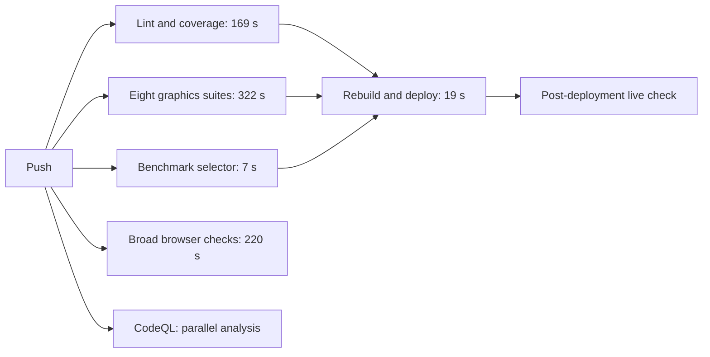

# GitHub Actions: faster releases and clearer feedback

Status: review only. No workflow or deployment behavior changed in this branch.
Base: `d5f9677a56c39d3766c8db0898c34c44182b7d17` on main.
The preceding browser-stability fixes are already shipped and all their workflows passed.

## Goal and evidence

Give developers fast, dependable feedback and shorten the time from a good
commit to a verified live game, without silently removing release checks.
Keep the work easy for Claude Code to resume.

Reviewed all six repository workflows, the shared setup action, the render-host
runner, staging/fingerprint scripts, the live checker, and the managed CodeQL
workflow. Downloaded job and step timings for the three most recent completed
main runs of each workflow: 21 runs total. These are observational samples from
different commits and runner conditions, not a controlled before/after benchmark.

[Timing evidence](github-actions-timings.json) records the runs, commit identities,
step durations and measured rendering-suite groups. It contains no credentials,
signed download URLs or browser saves. Workflow wall time includes scheduling
and post-processing; job time and individual step time are listed separately.

## What currently delays a release

The latest [website release run](https://github.com/bitkojine/more-than-enough/actions/runs/41351705102)
took **347 seconds: 5 minutes 47 seconds**. The previous two took 348 and 320 seconds.
The runner queue at workflow start was zero in all three.

| Job in the latest website run | Job duration | Main work |
| --- | ---: | --- |
| Tests | 169 s | Coverage 145 s; lint/format 9 s |
| Rendering | 322 s | Eight browser suites run sequentially: 308 s |
| Conditional benchmark selector | 7 s | Benchmark correctly skipped for the test/docs-only commit |
| Deploy | 19 s | Reinstall, rebuild, upload and deploy; Pages deployment itself 6 s |

Tests, rendering and the conditional benchmark **already run in parallel**.
Deploy waits for all three. The graphics job determines when this release can
proceed; putting the existing jobs in another order will not shorten that path.

The graphics step, from actual group timestamps in that same run:

| Suite | Seconds | Natural group |
| --- | ---: | --- |
| Illumination | 26.94 | World |
| Layering, timer subjects and controlled world input | 43.26 | World |
| Rendering performance | 95.18 | World |
| HUD | 39.13 | Interface |
| Performance panel | 37.26 | Interface |
| Fullscreen | 17.82 | Interface |
| Progression | 38.20 | Interface |
| Lab pacing | 10.91 | Interface |
| **World total / interface total** | **165.38 / 143.32** | |

## Recommended first change: two independent graphics jobs

Split the eight suites into **world** and **interface** matrix jobs, on separate
runners. Run each suite exactly once, keep every current assertion, retain
separate failure evidence, and require both jobs before deployment.

With comparable runner performance, each group would take about 2.4–2.8 minutes
plus setup. The critical path would become the slower of those groups and the
unit/coverage job. A reasonable first target is **roughly 3–3½ minutes to deploy**
instead of almost six. This is an estimate; measure the resulting workflow.

This modest extra parallelism adds one runner's setup overhead, while leaving
almost all test work unchanged. Eight separate runners are unnecessary: unit
coverage would become the next bottleneck anyway. Functional grouping is also
easier to understand than an arbitrary perfectly balanced assignment.

Implementation outline:

1. Let `scripts/check-render-host.mjs` select an explicit named group; preserve
   a default that runs all suites for manual use.
2. Keep the group definitions in that runner, with a small configuration check
   proving that the groups cover the full suite list exactly once.
3. Use a two-entry matrix in `.github/workflows/pages.yml`.
4. Give each group's evidence a unique artifact name. Use `fail-fast: false`
   so a sibling failure does not discard useful evidence.
5. Deploy only when both matrix entries and the existing other gates succeed.
6. Compare wall time and summed job duration on subsequent runs; don't claim
   a speedup from a single favorable runner.

**Do not run these Chrome suites concurrently on the same runner.** The browser
harness currently kills stale processes matching its shared profile prefix.
Parallel hosts there can terminate one another; CPU/GPU contention also spoils
performance evidence. Separate matrix runners avoid that collision.

## Review of every pipeline

Ranges below are workflow wall time over the three inspected completed runs.

| Pipeline | Observed range | Relationship to shipping | Recommendation |
| --- | --- | --- | --- |
| Test and deploy | 5:20–5:48 | Website release gate | Split serial graphics checks first; then promote a tested artifact |
| Browser suite | 3:44–6:31 | Independent, does not block Pages | Keep the smoke contract; continue extracting controlled fixtures; report a recovered first failure |
| Commit messages | 0:09–0:10 | Independent, does not block Pages | Keep; not a material bottleneck |
| Room service | 1:15–1:33 | Independent worker deployment on matched paths | Narrow frontend-only triggers carefully; evaluate duplicate root tests separately |
| Extended property checks | 4:23–7:55 | Independent, not a Pages dependency | Keep long exploration asynchronous/manual; audit trigger completeness |
| Live check | 0:15–0:25 | After either deployment and hourly | Distinguish pending deployment from confirmed healthy live state |
| Managed CodeQL | 2:29–2:35 | Independent of Pages | Keep parallel; it is not delaying website deployment |

### Website artifact and setup reuse

The renderer stages the site, the broad browser job stages it again, and deploy
stages it yet again. Deploy does not currently promote the precise artifact
that browser checks opened. Build once and publish a content-identified artifact;
let required checks inspect it and deploy those exact bytes. This improves
release provenance and removes repeated staging, even if staging itself is only
a few seconds and not today's main delay.

The shared setup action runs `npm ci` each time without an explicit npm download
cache. Setup currently takes about 5–7 seconds, so caching is worthwhile routine
cleanup, not the headline speedup. Cache downloaded packages against lockfiles;
continue clean installs. Consider a declared Node LTS major instead of resolving
`lts/*` with `check-latest` independently in every job. Keep the pinned toolchain
consistent locally and in CI.

### Avoid unnecessary test/docs deployments, with complete inputs

The last push changed only README and browser tests, but still ran the complete
website deployment, coverage, browser and security jobs. Tests must still validate
the changed harness. They do not inherently require republishing identical game
bytes or rerunning unrelated rule simulations.

Introduce a shared, explicit change classification with a conservative fallback:
production/build/shared changes get broad gates; tests run their relevant checks;
documentation gets link/reference/format checks. Unknown inputs run the full set.
Cover multi-commit pushes, PR bases, initial/unknown bases, deletions and renames.
Retain stable check names and explicit outcomes for intentionally skipped work.

**Do not use the current source fingerprint alone to skip deployment.**
`scripts/stage-site.sh` includes `autoplay-lab.css`, while
`scripts/site-hash.sh` omits it. The fingerprint also omits staging scripts and
build dependency/toolchain inputs that can alter shipped output. Complete the
input model or compare verified built artifacts before relying on “same hash.”
The previous test-only patch was separately verified to modify only tests/docs;
it does not establish that every equal-hash commit has identical build output.

Don't market an import graph or AST diff as proof that a change cannot affect
behavior. Use those tools to help maintain conservative selection, with broader
checks on uncertain/shared changes.

### Room-service duplication and trigger coupling

The room workflow reruns root `npm test` (44–60 seconds in this sample), even
when Pages runs those same tests with coverage. Sharing a verification result
for the exact commit can reduce duplicate work. However, making the worker wait
for coverage would delay worker-only release feedback: this is a tradeoff, not
an automatic win. Avoid making server-only changes wait for all graphics suites.

Its trigger includes all `src/i18n/**`: release notes and frontend diagnostic
text can cause unnecessary worker deployments. Check actual worker imports
before narrowing; core modules and the admin page genuinely use translations.
Release-notes-only modules are a clear candidate to examine.

There is a hidden coupling: `scripts/live-check.mjs` scrapes the `paths` array
from `.github/workflows/rooms.yml` with a regex, then converts it into Git paths.
Negative filters or a different YAML layout cannot safely be added without
updating that logic and its tests. Prefer one explicit shared definition of
worker build inputs and trigger expectations.

Keep deployments serialized. If separating validation from deployment later,
cancel stale validation while preserving an in-progress worker publish and its
post-deploy smoke check. Do not blindly enable mid-deployment cancellation.

### Broad browser retry policy

The independent browser job retries the entire approximately 350-check journey
once in a fresh random world. That doubled work in the failed timer-release run:
375 seconds were spent in its browser step. The two failures were different.
A second green run is useful evidence, but does not explain the first failure.

The recent patch establishes the direction: explicit known terrain, pointer
behavior checked against exact targets, synchronous isolated outline geometry,
negative controls, and deadlines with observed-state diagnostics. Keep random
seeds for generation/property/playthrough coverage. Split remaining journey
sections incrementally; don't rewrite every check in one unreviewable change.
Record the first failure even when a retry recovers so flakiness stays visible.

### Long properties and benchmark scope

The 1,500-seed sweep is already outside the website gate; keep that arrangement.
It currently triggers on core, networking, property tests and its workflow.
Audit missing indirect inputs such as shared test helpers, dependency lockfiles,
the Node version and the setup action before adding more skip logic.

The conditional benchmark is cheap when skipped, and ran in 24 seconds of
benchmark work in one inspected rules-changing run. Its default driver is the
legacy core-action regression helper, **not** the shipped AUTO controller or a
win in the current crystal chapter. Name and document its scope accurately;
do not treat its green result as a current-world end-to-end victory. Its imported
seed list is also outside the current changed-path list.

### Live-check status semantics

The checker intentionally permits a 30-minute deployment grace period and only
reports failed completed workflows. A changed build still deploying within that
grace period can therefore yield no problems and print “All live and green.”
That is not evidence that the new site is already live. A room deployment can
also trigger it while Pages for the same change is still running.

Model **pending**, **healthy**, and **failed** separately. Check the intended
commit/artifact and expose site readiness, worker readiness and remaining checks
independently. Pending should not create a false outage, but should not be
announced as a completed release. Keep the existing hourly health check.

### CodeQL access limit

CodeQL is managed by GitHub default setup, not a YAML file in this repository.
Observed jobs analyze Actions and JavaScript/TypeScript in parallel. Its actual
runs were inspected, but the API for reading default-setup configuration returned
“Resource not accessible by integration.” Don't claim its repository settings
were read or change its coverage merely to speed a pipeline it does not block.

## Order of work for Claude Code

1. **Two graphics groups:** largest measured release-time gain while preserving
   every gate. Add only small configuration tests and relevant browser checks.
2. **Truthful live status:** remove the ambiguity between deployment pending and
   verified live; test grace periods, overlapping deploys and current artifacts.
3. **Artifact/input correctness:** complete build inputs, build once, test and
   promote the same artifact. Then safely skip identical product deployments.
4. **Conservative test selection:** reduce repeated work on docs/test-only pushes;
   keep broad fallback for shared/unknown inputs and audit worker/property triggers.
5. **Routine caching and fixture extraction:** small setup savings; continue reducing
   browser flakiness without adding fixed sleeps or weakening assertions.

Keep checkpoints on a separate working branch until a change is validated.
Measure each improvement against this baseline. Preserve bitkojine's commit
identity, existing worlds, coverage floors and performance budgets. The review
branch itself changes documentation/evidence only and should not deploy the game.
